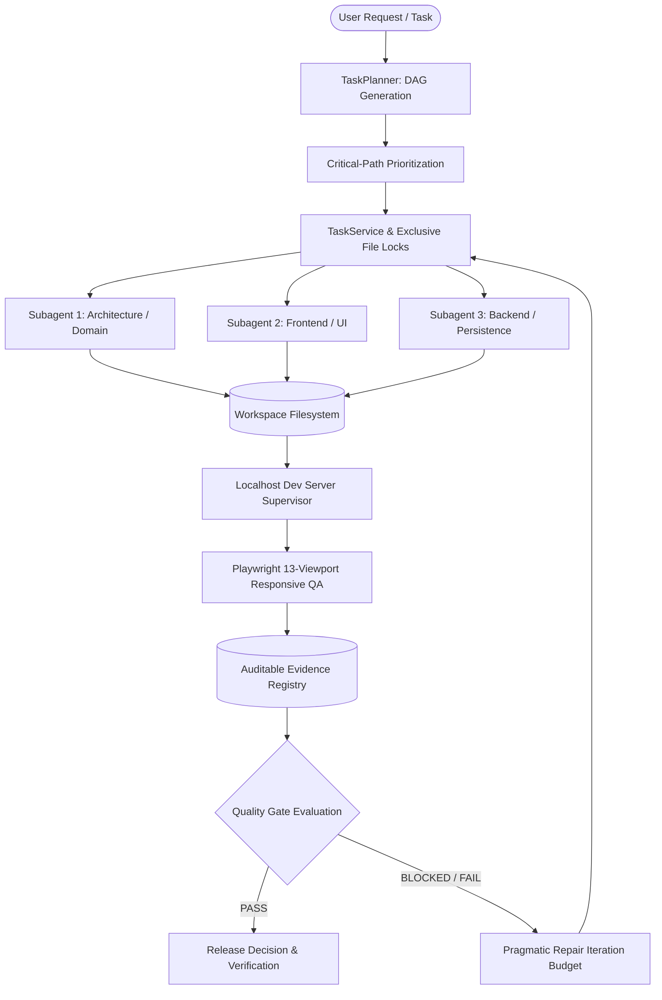

# Craftrig

> Autonomous Multi-Agent Engineering & Quality Governance Rig for AI Coding Agents.

[](LICENSE)
[](https://github.com/vickymosafan)
[](package.json)
[](tsconfig.json)
[](https://modelcontextprotocol.io)
[](tests/)

Craftrig is an open-source Model Context Protocol (MCP) server engineered to orchestrate multi-agent coding workflows with Clean Architecture, deterministic file locking, topological critical-path task scheduling, and automated localhost browser QA.

---

## 🏛️ Architecture Overview



---

## ⚡ Core Capabilities

1. **Topological Critical-Path DAG Scheduling**:
   - Analyzes directed acyclic graphs using Kahn's algorithm and reverse topological dynamic programming.
   - Automatically prioritizes ready tasks that have the highest downstream transitive reach to minimize overall workflow completion time (*makespan*).
2. **Deterministic File Ownership & Lock Recovery**:
   - Exclusive path-level write locks prevent parallel agents from corrupting the same source files.
   - Automatic recovery of stale or orphaned locks held by completed or abandoned tasks.
3. **Plan Intelligence Dashboard (`craftrig_get_plan_insights`)**:
   - Delivers real-time panoramic health metrics, remaining critical path chains, active bottlenecks, and prioritized next actions.
4. **Pragmatic Implementation Ladder (Lazy Senior Dev Principle)**:
   - Enforces YAGNI, reuse of existing models, platform standard primitives, and minimal surface area to eliminate code slop and drastically reduce token usage.
5. **Localhost Browser & 13-Viewport Inspection**:
   - Automated batch scanning using host Google Chrome to inspect responsive layouts, detect horizontal overflows, and catch console/network errors in under 4 seconds.

---

## 🚀 Quickstart Tutorial

### 1. Prerequisites
- **Node.js**: `v22.12.0` or higher
- **Package Manager**: npm, pnpm, yarn, or bun
- **Google Chrome**: Installed on the system (or Playwright Chromium)

### 2. Installation & Verification
```bash
# Clone the repository
git clone https://github.com/vickyymosafan/mcp-craftrig.git craftrig
cd craftrig

# Install dependencies
npm install

# Run the complete test suite and verification check
npm run check
```

---

## 🔌 Connecting Craftrig to MCP Clients

### A. Claude Desktop
Add Craftrig to your `claude_desktop_config.json`:
```json
{
  "mcpServers": {
    "craftrig": {
      "command": "node",
      "args": [
        "d:/craftrig/dist/src/index.js"
      ],
      "env": {
        "CRAFTRIG_WORKSPACE_ROOT": "d:/your-target-project"
      }
    }
  }
}
```

### B. Cursor & Windsurf
Add to your `.cursor/mcp.json` or global MCP settings:
```json
{
  "mcpServers": {
    "craftrig": {
      "command": "node",
      "args": [
        "d:/craftrig/dist/src/index.js"
      ]
    }
  }
}
```

### C. Claude Code CLI
```bash
claude mcp add craftrig -- node d:/craftrig/dist/src/index.js
```

---

## 🛠️ MCP Tools Reference

| Tool Name | Scope | Description |
| :--- | :--- | :--- |
| `craftrig_start_blueprint_interview` | Blueprint Architect | Adaptive deep requirements interview with repo pre-fill, recommended defaults, and elicitation schema. |
| `craftrig_answer_blueprint_questions` | Blueprint Architect | Submits answers, runs Blueprint Linter, and compiles `blueprint.md` + `blueprint.json` with `REQ-ID`s. |
| `craftrig_ingest_blueprint` | Autopilot | Compiles all blueprint phases into a multi-phase DAG with token-saving skill routing. |
| `craftrig_autopilot_next` | Autopilot | Advances the autopilot loop: zero-token deterministic checks, parallel subagent wave manifests, and targeted repair. |
| `craftrig_autopilot_resume` | Autopilot | Recovers expired leases/locks after crash and resumes the active wave. |
| `craftrig_create_execution_plan` | Planning | Generates a persistent task DAG with workstreams, domain roles, and checkpoints. |
| `craftrig_get_plan_insights` | Intelligence | Panoramic overview of critical path, bottlenecks, lock risk, and recommended actions. |
| `craftrig_get_ready_tasks` | Scheduling | Returns pending tasks whose dependencies are satisfied, sorted by downstream impact. |
| `craftrig_claim_task` | Concurrency | Claims a ready task for an agent and acquires exclusive path-level write locks. |
| `craftrig_claim_ready_batch` | Concurrency | Atomically claims multiple ready tasks simultaneously for parallel subagents. |
| `craftrig_heartbeat_task` | Concurrency | Extends the lease expiration of a long-running in-progress task. |
| `craftrig_acquire_file_locks` | Concurrency | Locks additional workspace-relative paths for an in-progress task. |
| `craftrig_release_file_locks` | Concurrency | Releases acquired file locks upon task completion or step handover. |
| `craftrig_recover_stale_locks` | Recovery | Reclaims orphaned locks left by completed, failed, or timed-out tasks. |
| `craftrig_record_evidence` | Verification | Records auditable evidence (test reports, screenshots, build logs). |
| `craftrig_evaluate_quality_gate` | Quality Gate | Assesses all required acceptance criteria checkpoints before release and emits a Conventional Commits 1.0.0 message on PASS (no push). |
| `craftrig_prepare_commit_message` | Release | Generates a Conventional Commits 1.0.0 git commit message from plan handoffs or working tree git changes without pushing (`noPush: true`). |
| `craftrig_archive_plan` | Lean Storage | Brotli-compresses completed plans to `.craftrig/archive/<planId>.json.br` and runs incremental vacuum. |
| `craftrig_storage_maintenance` | Lean Storage | Reports storage stats, compacts SQLite WAL, and enforces the 50 MB LRU evidence quota. |
| `localhost_start_dev_server` | Runtime | Starts and monitors local development servers. |
| `localhost_inspect_responsive` | Browser QA | Runs Playwright batch responsive scan across 13 viewport profiles. |
| `localhost_audit_visual_a11y` | Visual & A11y QA | Runs dual-theme (`light`/`dark`) `@axe-core/playwright`, composited contrast, polarity, typography, occlusion, target-size, reduced-motion, and `ariaSnapshot` audit. |
| `localhost_run_interaction_scenario`| Browser QA | Executes non-destructive UI interaction sequences. |

---

## 👤 Author & Maintainer

* **Author**: **vickymosafan**
* **GitHub**: [@vickymosafan](https://github.com/vickymosafan)

---

## 📄 License

This project is open-source software licensed under the **MIT License**. See the [LICENSE](LICENSE) file for details.
